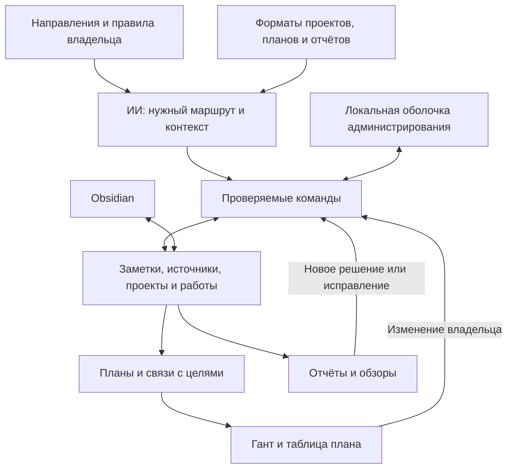

# Универсальный второй мозг: концепция, структура и план продукта

Концепция предложена 21.11.2026. В ней зафиксированы требования владельца к открытому продукту, структуре папок, настройке через ИИ, направлениям, форматам проектов и отчётов, OKR и универсальному Ганту. 22.11.2026 согласовано назначение локальной браузерной оболочки. 23.11.2026 владелец выбрал Codex для вопросов по рабочим записям и вкладку «Входящие» в админке для сбора материалов. [Реализованные этапы и критерии приёмки](../ROADMAP.md#порядок-поставок) · [Автоматические проверки](../tests/)

Существующий продуктовый черновик соседней ветки прочитан. После замечания владельца, что там его поняли неточно, он не используется как согласованная спецификация. Эта концепция формулирует самостоятельное предложение. Утверждения о спросе менеджеров, обязательных двух профилях и выборе отдельного приложения не принимаются здесь как требования владельца.

## 1. Основное решение

**Один второй мозг для разных сторон жизни и работы.** Владелец описывает, чем занимается, и получает направления со своими правилами и материалами. Когда появляется конечная работа, он создаёт проект. Когда нужны сроки, цели или регулярный обзор, подключает соответствующий способ планирования и отчётности. Система помогает сохранять, находить, связывать и актуализировать знания между чатами.

При первом запуске не требуется выбирать класс пользователя «личный» или «менеджер». У одного человека могут одновременно быть «Дом», «Работа», «Парфюмерия» и «Обучение». Различается включённый набор возможностей, а не основная модель данных. Стартовые примеры и пресеты допустимы как необязательные способы заполнить настройки.

22.11.2026 владелец выбрал три равноправных сквозных примера для первой поставки. Одно синтетическое хранилище объединяет «Управление ИТ-проектами» с двумя конечными проектами, «Личное» с памяткой и «Парфюмерию» с наблюдением о пробе. В действующем деморежиме на этих данных можно задать свой вопрос, открыть строки источника и добавить своё направление. [Сценарий показа](demo-scenarios.md)

**Повседневная работа владельца проходит в Codex и Obsidian.** В Codex владелец задаёт вопросы и поручает обновить записи, в Obsidian читает и редактирует те же Markdown-файлы. Локальная браузерная оболочка получает постоянное назначение — администрирование выбранного хранилища. Деморежим сохраняет отдельный вход для знакомства на синтетических примерах. Рабочий режим уже открывает выбранное хранилище, показывает обзор и карту связей и позволяет редактировать карточки. [Запуск рабочего режима](../README.md)

## 2. Что принадлежит каждому слою

| Слой | Ответственность | Что пользователь меняет |
|---|---|---|
| Данные и знания | Заметки, первичные материалы, подтверждённые события, решения и ссылки | Содержание своей базы |
| Направления | Длительные области жизни/работы, границы, интересы, текущие приоритеты и правила отбора материалов | «Чем я занимаюсь и что для меня важно» — основной уровень персонализации |
| Люди и отношения | Единые карточки, роли в разных контекстах, наблюдения, договорённости и источники | Какие сведения о взаимодействии сохранять; оценочные форматы включаются отдельно |
| Организация работы | Проекты, задачи, планы, цели, OKR; правила их ведения и необходимые поля | Как планировать конкретную деятельность |
| Представления | Списки, карта связей, обзор текущего состояния, Гант, отчёты и снимки за период | Как видеть и обсуждать накопленную информацию |
| Работа ИИ | Выбор маршрута, получение нужного контекста, предложение изменений, проверка и сохранение результата | Разрешённые действия, стиль, бюджеты, выбранный клиент/модель |
| Общее ядро | Файлы и ссылки, поиск, схемы, операции записи, история, проверки, извлечение правил, восстановление после прерывания | Обычно обновляет вместе с продуктом, без изменения собственных заметок |

Владелец выбирает для направления подходящий способ организации. Бытовая задача может лежать прямо в личном направлении, а работа с конечным результатом — получить свой проект. ОКР можно подключить, когда нужен формат для целей и ключевых результатов. Для Ганта источниками служат карточки работ и состав выбранного плана. Во всех представлениях у задачи общий ID и один срок.

## 3. Понятная структура нового хранилища

В новом пустом хранилище сразу создаются перечисленные папки, стартовая страница и страница настройки. Имена папок всегда английские — решение владельца от 21.11.2026. Текст заметок, заголовки и названия направлений могут быть на языке владельца. На главной показываются только используемые разделы; папки не заполняются фиктивными проектами и отчётами.

| Папка или файл | Что лежит внутри | Пример |
|---|---|---|
| `Home.md` | Направления, актуальные работы, недавние заметки, необработанное и следующие действия | «Дом: выбран материал; далее — замер» |
| `Start-Here.md` | Первый запуск и короткое обращение к ИИ; требования к среде и подключению | «Помоги настроить это хранилище под мои занятия» |
| `Inbox/` | Новые записи, которые ещё предстоит разобрать | Голосовая расшифровка, идея, заметка после встречи |
| `Directions/` | По одной понятной карточке на направление | `Дом.md`, `Работа.md`, `Парфюмерия.md` |
| `Notes/` | Самостоятельные знания, идеи, инструкции, решения, личные записи | Рецепт, конспект, способ настройки оборудования |
| `People/` | Единые карточки людей, отношения, подтверждённые наблюдения и договорённости | Коллега, заказчик, подрядчик, знакомый |
| `Projects/` | Работы с конечным результатом; их текущее состояние и задачи | `Kitchen-Renovation/Project.md` |
| `Tasks/` | Отдельные работы с устойчивым ID, необязательным сроком и историей переноса | `Проверить восстановление базы.md` |
| `Plans/` | Наборы работ, порядок, связи с целями, годовые/квартальные планы и OKR | `Планы на год.md`, `Ремонт — план.md`, `OKR команды.md` |
| `Reports/` | Сохранённые обзоры и отчёты за период | Недельный обзор, итог проекта, отчёт по цели |
| `Sources/` | Первичные документы, вложения и обработанные разборы с происхождением | Договор, статья, протокол встречи, разбор эксперимента |
| `Archive/` | Завершённое и прежние версии, доступные по запросу | Законченный проект, прошлогодний план |
| `Settings/` | Понятные владельцу правила, форматы работы, шаблоны, словарь и список возможностей | Как вести проекты и составлять недельный обзор |

Во вкладке «Входящие» вставленный текст сохраняется в `Inbox/` как Markdown. Загруженные документы, скриншоты переписки и другие вложения сохраняются в исходном виде. При последующем разборе оригиналы хранятся в `Sources/Originals/`, квитанции с результатами и вопросами владельцу — в `Sources/Processed/`. Для текстовых оригиналов UTF-8 в форматах Markdown и TXT подтверждённые фрагменты привязаны к конкретным строкам. Повторный обход узнаёт материал по содержимому.

`Notes/` может иметь удобные человеку тематические подпапки. Связь с направлениями хранится отдельно: положение файла не является единственным способом определить его смысл. Люди имеют самостоятельный раздел `People/`: одна карточка на человека независимо от количества ролей и направлений. Форматы командных наблюдений, 1:1 и PerfRew подключаются отдельно; обычный контакт не обязан иметь оценку вклада.

Технические идентификаторы папок стабильны (`inbox`, `directions`, `notes`, `people`, `projects`, `plans`, `reports`, `sources`, `archive`, `settings`); английские имена каталогов задаёт конфигурация, а подписи интерфейса могут локализоваться. Код не распознаёт папку по строке «Дом» или по номеру в начале имени. Нумерация папок не обязательна. Контролируемое переименование обновляет пути и ссылки; одного стабильного ID недостаточно для починки обычных Markdown-ссылок.

Порядок работы с сезонными циклами и людьми показан на синтетических примерах. [Приёмка сезона и карточки человека](../ROADMAP.md#как-проверить-сезон-и-людей)

Текущее рабочее хранилище PerfQA не переименовывается этой инициативой. Для него сохраняется адаптер прежних путей. Новая структура применяется к новому продукту и синтетическим примерам.

## 4. Направление — главный способ персонализации

Направление отвечает на вопросы:

- Что сюда относится и где граница с соседними направлениями?
- Что важно владельцу сейчас и какие материалы полезно сохранять?
- Какие проекты и заметки уже связаны с этой областью?
- Нужны ли для неё планы, обзоры или специальные форматы?
- Какие термины, ограничения и предпочтения надо учитывать?

Пример содержания карточки «Парфюмерия»: «Сохранять составы и наблюдения по пробам. Отделять формулу от впечатлений. Единицы измерения указывать явно. Интересуют древесные композиции. Пока отчёты и сроки не нужны». Для «Работы» человек может включить проекты, недельный обзор и OKR. Для «Дома» — список решений и Гант ремонта, когда он понадобится.

ИИ предлагает начальную структуру из описания владельца и показывает, что создаст. Название направления и его содержание можно изменить обычной фразой. Не требуется редактировать Python или создавать новый skill для каждого хобби.

### Контракт карточки направления

Для хранения достаточно устойчивого ID, названия, описания границ, связей и нескольких необязательных настроек. Срок, DRI и процент готовности не обязательны. Приоритет направления, если нужен, не означает готовность к завершению.

Проект или заметка может относиться к нескольким направлениям, но имеет одно основное место хранения. Например, проект «Уголок для смешивания ароматов» связан с домом и парфюмерией. Оба обзора показывают одну карточку.

Настройки включают ссылки на выбранные форматы и явно заданные предпочтения. Направления не получают собственные копии схем, скриптов и полного набора инструкций. Для совпадающих направлений не используется неявное правило «последнее победило»: правила конкретного документа/выбранного формата имеют явный приоритет, конфликт существенных требований показывается владельцу.

Чувствительность данных задаётся независимо от направления. Принадлежность к «Работе» или «Дому» сама по себе не является разрешением передавать материал внешней модели.

## 5. Проекты, планы и отчёты настраиваются отдельно

Предлагаемое место пользовательских форматов — `Settings/Formats/`, шаблонов — `Settings/Templates/`. Поставляемые определения и пользовательские дополнения имеют разное владение: обновление продукта не перезаписывает правки владельца. Обязательные схемные проверки нельзя случайно отменить оформительской настройкой.

| Объект | Что он хранит | Что можно настроить |
|---|---|---|
| Проект | Конечный результат, фактическое состояние, следующий шаг, связанные задачи и основания | Дополнительные поля, этапы, чеклист, критерии завершения |
| Задача/веха | Конкретная работа или контрольный результат | Сроки, зависимости, исполнители, подтверждение завершения; необязательные поля |
| План | Какие работы собраны вместе, порядок и группировка, горизонт | По направлениям, проектам, целям, людям или периодам |
| Цель/OKR | Желаемый результат, измерение, целевые значения, связи с работами | Цикл, метрики, правила расчёта; подключается при необходимости |
| Отчёт | Снимок за период, источники и дата актуальности | Аудитория, разделы, стиль, охват, периодичность |

Примеры запросов: «Для ремонта отмечай бюджет и подрядчика», «Для экспериментов нужна формула и результат пробы», «Давай каждую пятницу делать обзор по работе: сделано, риски, решения». ИИ превращает это в конкретный формат и пример документа. Изменение формата для будущих документов отделяется от миграции уже существующих.

Периодичность означает настройку выпуска. Автоматический запуск возможен только при наличии явно настроенного исполнителя/расписания. Нельзя обещать, что заметка с расписанием сама запускает ИИ.

### Одно место ведения работ

В первой версии мелкие задачи могут жить как структурированный список внутри проекта, с устойчивыми ID. Не создавать отдельный Markdown-файл для каждой галочки. Если нужна задача без проекта, допускается самостоятельный список задач в `Notes/` с тем же контрактом идентификации; фиктивный проект «Прочее» не обязателен.

План ссылается на ID существующих работ. Номер строки, название и положение в дереве не являются идентификатором. Общие поля работы — статус, исполнитель, согласованный срок, текущий прогноз — принадлежат её основной записи. План хранит состав и представление. Вариант «что, если» хранится как явно обозначенный сценарий и не изменяет основной прогноз до применения.

У OKR фактическое значение метрики берётся из источника. Процент выполненных задач не подменяет достижение результата. У новой работы неизвестные сроки/прогресс остаются неизвестными, а не заполняются моделью для красивой диаграммы.

## 6. Гант — универсальное представление планируемых работ

Гант показывает работы с датами и зависимостями. Он подходит для ремонта, учебного проекта, разработки продукта, годового плана и инициатив OKR. Сначала он должен работать на обычных проектах без обязательных квартала, КР и корпоративной нумерации.

| Что открывает владелец | Возможная группировка | Откуда берутся работы |
|---|---|---|
| Все дела на ближайшие месяцы | Направление → проект → задачи | Выбранные проекты и самостоятельные задачи |
| Один ремонт | Этап → задача/веха | Один проект |
| План команды | Проект → задача, либо исполнитель → задача | Несколько проектов |
| Годовые цели или OKR | Цель → КР/инициатива → связанные работы | План со связями к общим работам |

Одна работа может быть видна в нескольких представлениях. Перенос срока через Гант и изменение через чат используют одну команду сохранения, одну проверку версии и одну историю. Таблица плана показывает те же данные. Повторное открытие другого представления не создаёт отдельный статус.

Проектные критерии полной версии Ганта перечислены ниже. В этапах 3.2–3.4 реализованы оба интерфейса, обзор плана, редактирование строк, обратный поток, три независимые даты, вехи и расчёт влияния зависимостей на прогноз. [Поставленная версия и следующие шаги](gantt.md)

1. Произвольный горизонт, проекты/задачи/вехи, фильтр по направлениям и раскрытие группы.
2. Различие согласованного срока, текущего прогноза и фактического завершения. Отсутствующие даты — отдельный видимый список, без выдуманных полос.
3. Явные зависимости и воспроизводимый предварительный расчёт переноса. Для первой версии достаточно понятной поддерживаемой семантики зависимости «после завершения»; неподдерживаемую связь нельзя молча превратить в неё.
4. Показ последствий до применения значимого переноса; защита более свежей ручной правки; история с автором, временем и основанием.
5. Контроль циклов зависимостей и недействительных дат. Факт, прогноз и сценарий «что, если» различаются визуально и в данных.
6. Доступ к краткой сводке и первичному основанию из строки. Завершение требует подтверждения результата, а не только прошедшей даты.

Для расчёта загрузки недостаточно пересечения двух полос у одного человека. Без заданной доступности и трудозатрат показывать пересечение и неизвестность; не обещать точный ресурсный план. Этот расчёт можно развивать отдельным модулем.

Из рабочего Ганта переносить проверенные механизмы команд, истории, прогнозов, предварительного расчёта и восстановления обратной связи. Его текущие связи с КР, кварталами, номерами строк и конкретной заметкой нужно отделить от общего формата. Это новая работа, её выполнение не следует из оптимизации SKILL.md.

## 7. Первый запуск и повседневное использование

### Первый запуск

1. Человек получает готовый стартовый комплект и открывает новую папку. Там уже есть понятная структура, «Главная» и «Начните здесь»; демонстрационные данные можно открыть отдельно.
2. Страница запуска объясняет, как подключить один из испытанных ИИ-клиентов. Подключение модели и доступ к папке — реальные предварительные шаги, их нельзя прятать за обещанием «ИИ всё настроит сам».
3. Пользователь описывает свои занятия: «Работа, дом, парфюмерия. По работе нужны проекты и недельный обзор». ИИ предлагает несколько направлений, их границы и нужные возможности.
4. После принятия конкретного предложения создаются карточки направлений, ссылки на выбранные форматы и навигация. ИИ задаёт только вопросы, без ответа на которые нельзя корректно продолжить; необязательное остаётся с понятным значением по умолчанию.
5. Первый полезный результат строится на одной реальной записи: найти ответ с источником, сохранить решение либо показать простой план. Демонстрационный Гант не выдаётся за план пользователя.
6. При следующем обращении система восстанавливает текущие настройки и состояние из файлов, не требует повторно рассказывать всю историю чата.

Настройка ограничена понятными решениями: направления, язык, часовой пояс, нужные способы работы, источники и доступ ИИ. Создание личных направлений не требует заранее выбирать OKR, регулярные отчёты, карточки сотрудников и Гант.

### Знакомство через деморежим

Деморежим открывается в отдельном хранилище. Из него видно, как один человек возвращается к техническому решению по нужному проекту, бытовой подробности или впечатлению о пробе. В каждом примере вопрос приводит к конкретной строке обычного файла. Последний шаг посетитель выполняет со своим материалом — называет новую область, сохраняет запись и задаёт свой вопрос. Начать можно с любой темы. [Сценарий показа](demo-scenarios.md)

### Администрирование рабочего хранилища

Владелец открывает админку существующего хранилища кнопкой **Второй мозг** в настольном Obsidian или командой `work` из терминала. Из вкладки Obsidian можно открыть текущий раздел в системном браузере и остановить локальный сервер. [Подключение плагина](../plugins/obsidian-gantt/README.md) В учебном WorkshopVault можно выбрать «Городская типография», открыть оба проекта и положить протокол встречи во «Входящие». Чтобы узнать, что решили по проектам, владелец спрашивает в Codex. Команда `ask` возвращает выдержки со строками источников и работает при закрытой оболочке. Правки в Obsidian учитываются при следующем чтении. При изменении карточки через оболочку или CLI проверяется прочитанная версия файла. [Инструкция](../README.md) · [Учебные данные](../examples/working_vault.py)

| Действие владельца | Что даёт рабочий режим |
|---|---|
| Управлять направлениями и проектами | Просмотреть, создать и отредактировать карточку, связать проект с направлением. Связи используют устойчивые ID. |
| Увидеть архитектуру хранилища | Карта показывает существующие записи и явно сохранённые связи между ними. Из каждого узла можно открыть карточку. |
| Проверить текущее состояние | Сводка показывает записанные статусы, ближайшие шаги и сроки там, где они заданы. Для сведений без подтверждения видно, что данных пока нет. |
| Добавить материал во «Входящие» | Вставить текст, добавить файлы или скриншот переписки. Сохранённые материалы доступны в `Inbox/` для следующего разбора в Codex. |
| Ответить на вопрос владельцу | Открыть спорный фрагмент и сообщить, например, к какому проекту относится указанный срок. Уточнение возвращает этот фрагмент в очередь. |

В разделе «Входящие» владелец выбирает строки документа, человека и направление каждого фрагмента. В разделе «Люди» видны текущая формулировка, исходная цитата и сохранённые версии. Личное наблюдение открывается отдельно для выбранного человека. Это граница выдачи данных в однопользовательском vault. Полный оригинал доступен владельцу при разборе. [Учебная встреча](../examples/meeting.md)

### Обычные сценарии

| Запрос | Действие системы |
|---|---|
| «Запомни эту идею для кухни» | Сохраняет небольшую заметку, связывает с домом и при необходимости с ремонтом |
| «Разбери запись встречи» | Сохраняет точную копию оригинала и связывает подтверждённые строки с человеком и нужными направлениями |
| «Что мы решили по вытяжке?» | Находит актуальное решение, дату и основание; показывает противоречие, если есть более новое уточнение |
| «Покажи всё, что относится к ароматам» | Собирает связанные заметки и проекты без дублирования файлов |
| «Перенесли доставку на неделю» | Находит нужную работу; при неоднозначности уточняет; показывает влияние на план и сохраняет принятое изменение |
| «Сделай обзор по работе» | Берёт заданный период и формат, сверяет актуальные факты и предыдущий выпуск |

Собственная заметка пользователя может сразу стать заметкой: обязательный отдельный Evidence-документ для каждого рецепта или списка не нужен. Для импортированных материалов, извлечённых фактов и изменений сводного состояния происхождение сохраняется. Необработанные документы не становятся подтверждёнными фактами только потому, что попали в папку.

## 8. Как ИИ работает с системой

Для задач и планов есть седьмой универсальный навык. Он создаёт карточки, включает задачу в выбранные планы и меняет её срок через предпросмотр. Клиент выбирает навык по действию и вызывает CLI. Владелец может править те же файлы в Obsidian. [Задачи и планы](../.agents/skills/brain-plan/SKILL.md) · [Каталог навыков](guide.md#как-ии-выбирает-навык)

Для недельного обзора навык читает закрытый план, события его работ за выбранные даты и точные строки оснований. Формат владелец настраивает в `Settings/Formats/Weekly.md`, готовый выпуск хранится в `Reports/`. Если работа встречается в двух выпусках, даты можно сопоставить по её ID. [Недельный обзор](../.agents/skills/brain-weekly-review/SKILL.md)

В текущей оптимизации уже есть полезные механизмы: компактный старт, точный поиск, извлечение правил и словаря, бюджет чтения и проверяемое продолжение обратной связи. В продукте правила выбираются по активному действию и типам объектов; содержание направлений добавляется адресно. Полный набор направлений, шаблонов и всех заметок не загружается в каждый запрос.

Входной текст и импортированные файлы не являются инструкциями, разрешающими изменить правила или получить дополнительные права. Критические ограничения извлекаются детерминированно; релевантность поиска определяет полезную фактуру, но не отменяет ограничения.

Рутинная явно запрошенная запись выполняется без бесконечных подтверждений. Предварительный просмотр необходим для массового переноса/удаления, замены настроек, затрагивающей существующие данные, и принятия новых обязательств по плану. После прерывания сверяются версии исходников и целей; повтор не размножает выполненные действия.

Чтение остаётся возможным без ИИ. Обновления инструментов, индекс и совместимость проверяются кодом. Выбор содержательного решения остаётся за владельцем/моделью в пределах задачи. Облачная модель не обязательна по архитектуре, однако поддержка каждой модели должна быть испытана: в прочитанном пилоте Qwen3 4B в заданном режиме не завершила поисковые и Inbox-задачи. Это результат конкретной конфигурации, а не доказательство непригодности всех малых моделей.

## 9. Хранение и поставка открытого проекта

Основные данные — Markdown с небольшим набором metadata и обычными вложениями. Индекс SQLite FTS5 перестраивается, не становится источником истины. Пользователь может открыть свои заметки обычным редактором. ID и версия схемы служебные; пользователь задаёт названия обычным языком.

Публичный репозиторий должен разделять:

| Каталог исходного продукта | Назначение |
|---|---|
| `core/` | Парсер, ссылки, индекс, чтение контекста, операции записи, конфигурация и общие проверки |
| `modules/` | Projects/планы, Гант, отчётность, OKR и дополнительные предметные возможности |
| `templates/` | Стартовый vault, локализация, базовые форматы и страницы |
| `.agents/skills/` | Переносимые инструкции по пользовательским операциям. Клиент отвечает за обнаружение и загрузку выбранного навыка |
| `interfaces/` | CLI для команд из Codex, работа с Obsidian и локальная браузерная оболочка с рабочим и демонстрационным режимами |
| `examples/` | Синтетические направления и связанные проекты; данные отделены от чистого шаблона |
| `tests/`, `docs/` | Контракты, сценарии, установка, настройка, обновление и вклад в проект |

Это предлагаемая структура нового репозитория исходников; она не показывается пользователю как обязательная структура его знаний. В пользовательской папке остаются разделы из пункта 3. Поставка может включать минимальный служебный адаптер, а изменяемые данные не смешиваются с исходниками продукта.

Создавать публичную поставку из явно отобранных файлов с новой историей, а не открывать существующий PerfQA. Проверить права на код и сторонние компоненты, выбрать лицензию после этой проверки. Примеры, тестовые данные, настройки и архивы не содержат рабочих фактов, корпоративных подключений и персональных наблюдений.

Первый релиз должен указывать испытанные ОС и ИИ-клиенты. Реальная цель — работа на macOS и Windows; готовность каждой платформы подтверждается установкой на ней. Git удобен для разработчиков и истории, но от обычного пользователя не требуется знание Git: доступная отмена и резервная копия должны иметь понятный путь.

Обновление продукта сохраняет заметки, пользовательские форматы, ручные сроки и источники. Смена схемы — отдельная проверяемая миграция с предварительным просмотром и восстановлением. Установка в существующую папку начинается с диагностики; файлы не заменяются вслепую.

## 10. План реализации по завершённым сценариям

Реализованы деморежим, рабочая оболочка и этап 2 с входящими, людьми и историей формулировок. На трёх демонстрационных направлениях владелец знакомится с моделью. Для проверки универсальности рабочего режима отдельный генератор создаёт типографию, дом и сад, полевые записи, пустое направление и заметку без направления. Названия и связи берутся из файлов. [Дорожная карта и критерии приёмки](../ROADMAP.md)

Этап 3 начался с задач и планов через Codex. Таблица плана и редактируемый Гант работают в админке и в настольном Obsidian. Вехи и зависимости доступны в плане и через навык. При закрытии цикла его состав и известные даты сохраняются в Markdown плана. В следующем цикле те же работы доступны по прежним ID. На этапе 4 появились недельные обзоры закрытых планов и опциональный OKR. Карточка ключевого результата хранит цель, замеры и ссылки на существующие задачи. Для будущей открытой альфы предстоит проверить установку, обновление и восстановление на целевых платформах. [Учебный сценарий OKR](guide.md#цели-и-ключевые-результаты)

Владелец хочет позднее добавить в оболочку шаблоны направлений и иллюстрации. Из готового примера можно будет начать собственную тему на общей модели карточек. Выбор тем, состав изображений и оформление библиотеки остаются отдельной задачей.

### Обязательные сквозные проверки

- В одном чистом хранилище создать три направления. Из нового чата найти отдельно решения по двум ИТ-проектам, ответ по личной памятке и наблюдение о парфюмерной пробе. У каждого ответа открываются его строки источника.
- В деморежиме добавить произвольное четвёртое направление, сохранить собственный материал и найти ответ на новый вопрос теми же средствами.
- Изменить решение по одному проекту в Obsidian. С закрытой оболочкой спросить в новом чате Codex о решениях по двум проектам. Открыть каждую ссылку и сверить её с актуальным файлом.
- Во вкладке «Входящие» сохранить текст, документ и скриншот. Сверить содержимое файлов в Obsidian и проверить их появление в очереди Codex.
- Одновременное личное и рабочее использование; включение формата в одном направлении не навязывает его остальным.
- Переименование направления и перенос файла сохраняют связи; несколько направлений не размножают заметку.
- Один проект виден в обычном плане, на Ганте и в OKR; нет противоречащих копий срока/статуса.
- Ручная правка одновременно с работой ИИ обнаруживается; повтор после прерывания не затирает её и не дублирует действие.
- Проект без дат и человек без заданной доступности не получают выдуманных оценок.
- Обычная заметка не требует корпоративных полей и отчётов; отсутствие сотрудников/OKR не является ошибкой.
- Обновление и откат сохраняют пользовательские форматы, вложения и подтверждённые решения.
- Поисковая выдача и обязательные правила укладываются в оговорённый бюджет; недостаток контекста обозначен явно.

## 11. Что уже можно взять, что предстоит сделать

| Статус | Компоненты |
|---|---|
| Реализовано в прототипе второго мозга | Инициализация папок, направления, проекты и заметки с устойчивыми ID, запись с проверкой версии, вопросы с источниками в Codex, редактирование карточек, карта связей, обзор состояния, отдельный деморежим со своими вопросами, приём и разбор входящих, карточки людей с исходными цитатами и историей |
| Опыт рабочего проекта PerfQA | Выборка правил и глоссария, диагностика, бюджеты чтения, восстановление обработки исправлений и механика Ганта |
| Исторический пилот PerfQA | Автономное чтение с профилем personal вне рабочего vault |
| Реализовано на этапе 3.1 | Задачи, планы со ссылками по ID, предпросмотр изменения срока и сохранение истории в карточке задачи |
| Реализовано на этапах 3.2–3.5 | Редактируемый Гант, независимые даты, вехи и зависимости, закрытие цикла и чтение его итога |
| Реализовано на этапах 4.1–4.2 | Недельный обзор закрытого плана с источниками, опциональные ключевые результаты с историей измерений и связями по ID задач |
| Реализовано для работы с людьми | Карточка одного человека в нескольких группах, независимый выбор своей карточки и команды, состав и источники для вопросов и решений в Codex |
| Запланировано для второго мозга | Пользовательские форматы, шаблоны направлений и иллюстрации, установка и обновления |
| Не входит в первый объём | Совместное редактирование многими людьми, серверный маркетплейс модулей, собственная облачная синхронизация, отдельная ОС/приложение вместо Obsidian, обязательная векторная БД |

В изученном пилоте PerfQA модуль `vault_profile.py` допускал два имени, perfqa/personal. Профиль personal содержал маршрут find и демонстрационные папки. В прототипе второго мозга новые направления уже создаются командами. Дальнейшие возможности направлений предстоит подключать через проверяемые настройки.

## 12. Вопросы для дальнейшего согласования

На трёх примерах можно проверить, понятны ли названия папок, легко ли различить источник решения по каждому проекту и удаётся ли добавить своё направление. Состав первого Ганта уточняется при проектировании этапа 3. Бренд и каталог интеграций можно обсуждать после проверки основной модели.
